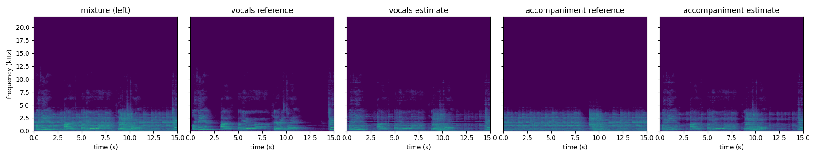

# multichannel-nmf — convolutive multichannel NMF for audio source separation

**multichannel-nmf** implements the EM algorithm of Ozerov & Févotte (2010) for multichannel
nonnegative matrix factorisation in convolutive mixtures: it takes a reverberant multichannel recording
and returns the spatial image of each source.



## Overview

- **Model.** In each frequency bin, the mixture STFT is `x(f, t) = A(f) s(f, t) + b(f, t)`, where `A(f)`
  holds the mixing filters and each source `s_j` is a sum of Gaussian components whose variances follow an
  NMF `W[f, k] H[k, t]`. EM estimates `A`, `W`, `H` and the noise variances; sources are recovered by
  multichannel Wiener filtering.
- **Data.** Two sources (voice and accompaniment, MUSDB18 stems) are convolved with binaural room impulse
  responses from the AIR database to simulate a two-microphone reverberant recording.
- **Context.** Course project, Télécom Paris (2nd year, TSIA track), course of Roland Badeau, June 2025.
  The submitted notebook (`notebooks/01_course_implementation.ipynb`) did not separate the sources, as stated
  in its conclusion. The `mnmf` package is a later vectorised rewrite of the same algorithm that fixes the
  second-order statistics of the E-step (outer products instead of inner products) and estimates the noise
  for each frequency.

## Results

Single run of `notebooks/02_demo.ipynb`: 15 s stereo mixture at 44.1 kHz, 2 sources, 4 components per
source, 100 EM iterations, random initialisation (seed 0). SDR is the energy ratio between the reference
spatial image and the estimation error, computed over both microphones; the baseline uses the mixture as
the estimate of each source.

| Source | SDR, mixture (dB) | SDR, estimate (dB) |
|---|---|---|
| Vocals | 2.37 | 3.34 |
| Accompaniment | -2.37 | -0.52 |

The gain is small: the Aula Carolina hall is far more reverberant than the 46 ms STFT window, which breaks
the narrowband approximation `x(f, t) = A(f) s(f, t)`, and EM starts from a random point.

## Installation

```bash
python -m venv .venv && source .venv/bin/activate   # Python 3.12
pip install -r requirements.txt
```

With OpenBLAS (default NumPy wheels), set `OPENBLAS_NUM_THREADS=1`: the E-step inverts one small matrix
per time-frequency bin, which is much faster single-threaded.

## Quick start

Run `notebooks/02_demo.ipynb` to simulate the mixture (written to `data/mixture.wav`), fit the model and
plot the separated spectrograms. To separate any multichannel WAV file:

```bash
OPENBLAS_NUM_THREADS=1 python separate.py data/mixture.wav --n-sources 2 --n-components 4 --n-iter 100 --out outputs
```

| Argument | Meaning |
|---|---|
| `--n-sources` | number of sources J |
| `--n-components` | NMF components per source |
| `--n-iter` | EM iterations |
| `--n-fft` | STFT window length in samples (hop = half window), default 2048 |
| `--out` | output directory; one multichannel `source{j}.wav` per source, in arbitrary order |

The same pipeline from Python:

```python
import soundfile as sf
from mnmf.separation import separate

mixture, sr = sf.read("data/mixture.wav")                     # (N, I)
images = separate(mixture.T, n_sources=2, n_components=4)     # (J, I, N)
```

## Repository structure

- `mnmf/stft.py`: multichannel STFT and inverse STFT.
- `mnmf/mixing.py`: loading of AIR impulse responses and simulation of convolutive mixtures.
- `mnmf/em.py`: E-step, M-step, normalisation and log-likelihood of the model.
- `mnmf/separation.py`: multichannel Wiener filtering and the end-to-end `separate` function.
- `mnmf/metrics.py`: energy-ratio SDR with permutation matching.
- `separate.py`: command-line entry point.
- `notebooks/01_course_implementation.ipynb`: notebook submitted for the course (in French).
- `notebooks/02_demo.ipynb`: simulation, EM fit and separation with the `mnmf` package.
- `docs/reading_note_fr.pdf`: reading note on the paper submitted for the course (in French).

## Method

EM follows Section IV of the paper. The E-step computes, for every bin `(f, t)`, the posterior mean and
covariance of the sources and of the NMF components given `x(f, t)`; the M-step updates in closed form

- `A(f) = R_xs(f) R_ss(f)^-1` and the diagonal noise covariance from the residual,
- `W[f, k] = mean_t u_k(f, t) / H[k, t]` and `H[k, t] = mean_f u_k(f, t) / W[f, k]`,

where `u_k(f, t)` is the posterior power of component `k`. After each iteration, the columns of `A(f)` are
scaled to unit norm and the columns of `W` to unit sum; the scales move to `W` and `H`, which leaves the
likelihood unchanged. Initialisation is random. The log-likelihood is returned at every iteration to check
convergence.

## Data

Nothing is committed; place the files in `data/`:

- MUSDB18 ([sigsep.github.io/datasets/musdb](https://sigsep.github.io/datasets/musdb.html)): the demo uses
  15 s mono excerpts (from 10 s) of the `vocals` and `other` stems of the first training track, saved as
  `data/vocals_mono.wav` and `data/guitar_mono.wav` (44.1 kHz).
- Aachen Impulse Response database v1.4 ([RWTH Aachen](https://www.iks.rwth-aachen.de/en/research/tools-downloads/databases/aachen-impulse-response-database/)):
  `data/AIR_1_4/air_binaural_aula_carolina_{0,1}_1_3_{45,135}_3.mat` (right and left ear, sources at 45° and 135°).

## References

1. A. Ozerov and C. Févotte, "Multichannel nonnegative matrix factorization in convolutive mixtures for
   audio source separation," *IEEE Trans. Audio, Speech, Lang. Process.*, vol. 18, no. 3, pp. 550–563, 2010.
2. M. Jeub, M. Schäfer and P. Vary, "A binaural room impulse response database for the evaluation of
   dereverberation algorithms," *Proc. Int. Conf. Digital Signal Processing (DSP)*, 2009.
3. Z. Rafii, A. Liutkus, F.-R. Stöter, S. I. Mimilakis and R. Bittner, "The MUSDB18 corpus for music
   separation," 2017, doi:10.5281/zenodo.1117372.

## Author

Quentin Revillon, Télécom Paris. Course supervised by Roland Badeau.
